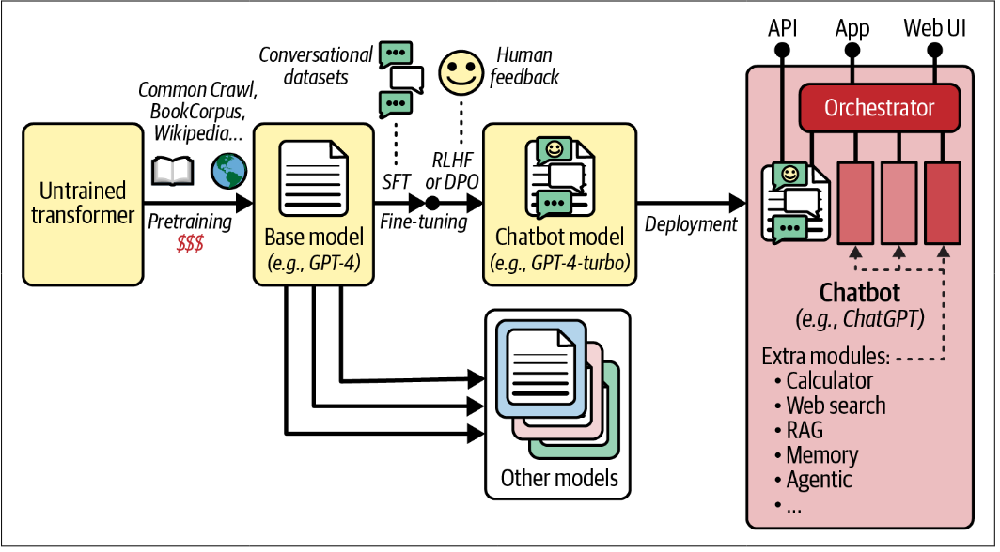

# Transformers for Natural Language Processing and Chatbots

En un paper de 2017 [ https://arxiv.org/abs/1706.03762 ] "Attention is all you need", un equipo de investigadores de Google propuso una nueva arquitectura de redes neuronales llamada "Transformer", la cual mejoraba sustancialmente la traducción automática SotA (state of the art). Esencialmente, era una arquitectura encoder decoder.

1. El texto original entraba al decoder, el cual generaba un embedding contextualizado (uno por token)
2. La salida del encoder se utiliza como entrada del decoder, así como el texto traducido hasta ahora (con un token de SoS)
3. El decoder predice el siguiente token para cada token de entrada
4. El último token de salida del decoder se agrega a la traducción 
5. Los pasos 2,3 y 4 se repiten una y otra vez hasta producir una traducción completa, un token cada vez, hasta generar un token de final de secuencia. En fase de entrenamiento, como ya se tiene la traducción completa, se le da al decoder en el paso 2, con lo que los pasos 4 y 5 no son necesarios

La diferencia yace dentro de la caja negra que es la arquitectura, ya que el Transformer no contiene ninguna capa recurrente o convolucional, únicamente capas densas combinadas utilizando un nuevo mecanismo de atención: MHA (multi-head attention), además de algún que otro truco. Gracias a que contiene solamente capas densas, no sufre de los problemas de explosión/desaparición de gradientes, se puede entrenar en menos pasos y puede paralelizarse la ejecución en múltiples GPUs, además de escalar sorprendentemente bien. Además, gracias al nuevo mecanismo de atención, es capaz de captar patrones en rangos más grandes.

> Es importante destacar que, aún que se planteó inicialmente para la traducción automática, ha resultado ser mucho más versatil, dando a la explosión del NLP, con lanzamientos como los chatbots de OpenAI, Anthropic, ... Pero no acaba ahí, ya que también son útiles para visión artificial, procesado de audio, robótica, ...

En este capítulo se seguirán los siguientes putnos:

- Diseccionar la arquitectura original de los Transformers para entender como funcionan
- Implementar y entrenar un transformer para la traducción automática de inglés a castellano
- Inspeccionar modelos encoder como BERT, aprender como se han preentrenado y como utilizarlos para tareas como clasificación de texto, búsqueda semántica y agrupado de texto, con y sin fine-tuning
- Inspeccionar modelos decoder como GPT, aprender como se han preentrenado. Estos modelos son capaces de generar texto, además de otras tareas
- Implementar un modelo decoder para construir un chatbot
- Estudiar modelos encoder-decoder para tareas como traducción y resumido de texto

## Attention is all you need: la arquitectura original del transformer

Como ya hemos visto, el objetivo del encoder es transformar gradualmente la entrada hasta que cada representación de los tokens capture perfectamente el significado en el contexto de la oración, generando una secuencia de incrustaciones contextualizadas de tokens. 

El rol del decoder es recoger las salidas del encoder, acompañadas de la traducción hasta este punto y predecir el token siguiente. Para esto, las capas del decoder transforman gradualmente cada representación de los tokens de entrdad en una representación que puede usarse para predecir el siguiente token.

Los tensores que reciben los encoders y decoders son los siguientes:
- **[batch size, max English sequence length in the batch, embedding size]**: al iterar la entrada original se transforman los tokens en una representación contextualizada del significado
- **[batch size, max Spanish sequence length in the batch, embedding size]**: al iterar la entrada de la representación de tokens conjuntamente con la traducción hasta el momento, se logra la predicción del siguiente token

Vale la pena resaltar unas cuantas cosas de la arquitectura:

- Tanto el encoder como el decoder contienen bloques que están apilados N veces, en el paper en concreto $N=6$, también que las salidas de la pila entera de encoder se utilizan como entrada en los N bloques del decoder.

- La mayoría de las capas ya son conocidas: hay dos capas de embedding, varias skip connections seguidas de modulos de normalización, varios modulos compuestos por dos capas densas (la primera con función ReLU y la segunda sin) y finalmente la salida es una capa lineal. Como cada capa ya mencionada procesa cada token por separado, es donde entran los nuevos componentes de la arquitectura:
    - La capa MHA del encoder actualiza cada representación de los tokens centrandose en cada token en la misma oración, excluyendolo a él, es decir, utiliza "self-attention". De esta manera las palabras con representaciones vagas como "like" adquieren significado en cada oración por separado
    - La MMHA(masked MHA) hace lo mismo que la MHA pero cuando ya ha procesado un token, ya no hace caso a los tokens que van después de él; es una capa "causal" (cuando procesa el token "gusta" de la frase "me gusta el fútbol" solo hace caso a los tokens "<s>" "me" "gusta" e ignora "el" y "fútbol")
    - La capa MHA del decoder es donde este presta atención a las representaciones de los tokens generadas por el encoder. Esto se conoce como "cross-attention".
    - Los encodings posicionales son vectores densos que representan la posición de cada token en la oración. El enésimo encoding posicional es añadido al token incrustado del enésimo token de cada oración. Esto es necesarío por que todas las capas de la arquitectura del transformer tratan todas las posiciones por igual: cuando procesan un token no tienen idea de donde viene o su relación con el resto de tokens

### Encodings posicionales

Como se ha explicado antes, un encoding posicional es un vector denso que codifica la posición de un token en relación a una oración: el enésimo encoding posicional es añadido (se suma) al token incrustado en la enésima posición en cada frase.

$$
\begin{align}
\text{input\_embedding}(i) &= \text{token\_embedding}(i) + \text{positional\_encoding}(i) \\
X_i &= E_i + P_i
\end{align}
$$

donde:

- $E_i$ = embedding del token en la posición $i$
- $P_i$ = codificación posicional de la posición $i$
- $X_i$ = entrada final que recibe el modelo

### Atención multicabeza

La capa MHA está basada en el la atención de producto punto escalado, una variante de la atención de producto punto que escala hacia abajo la similitud de las puntuaciones por un factor constante 

$$
\large
\text{Attention}(\mathbf{Q},\mathbf{K},\mathbf{V}) = \text{softmax}\left(\frac{\mathbf{Q}\mathbf{K}^\top}{\sqrt{d_k}}\right)\mathbf{V}
$$

Donde:
- $Q$ es la matriz que representa la query (p.j. una frase en ingles). Su forma es $[L_q, d_q]$ donde $L_q$ es la longitud de la query y $d_q$ es la dimensionalidad de la query
- $K$ es la matriz representando una clave. Su forma $[L_k, d_k]$ donde $L_k$ es la longitud de la clave y $d_k$ es la dimensionalidad de la clave
- $V$ es una matriz representando un valor. Su forma $[L_v, d_v]$ donde $L_v$ es la longitud del valor y $d_v$ es la dimensionalidad del valor.
- La forma de $QK^T$ es $[L_q, L_k]$: contiene una puntuación de similitud para cada para query-clave. Para evitar que la matriz sea enorme, la secuencia de entrada no tiene que ser demasiado larga, ya que se toparía con el problema de la ventana de contexto cuadrática. La función softmax se aplica a cada fila, resultando en una forma $[L_q, d_v]$, donde hay una fila por cada token de la query y cada fila representa el resultado de la query: una suma ponderada de los valores de los tokens, favoreciendo los valores de los tokens cuyos tokens clave se alinean más con el token de la query
- El facto de escalado es $\frac{1}{\sqrt{d_k}}$ escala hacia abajo la similitud de las puntuaciones para evitar sturar la función softmax, lo cual llevaria a gradientes muy pequeños.
- Es posible enmascarar algunos pares clave-valor añadiendo valores negativos muy grandes a las puntuaciones de similitud correspondiende antes de calcular el softmax

Ahora miraremos a la capa de atención con multiples cabezas.

Como se puede ver son una pila de capas de atención de productos punto escalados llamadas cabezas de atención, cada una precedida por una transformación lineal de valores, llaves y querys. La salida de todas las cabezas de atención son concatenadas y pasan por una transformación lineal final.

Ahora viene el porque: en una oración como "I like football", "like" tiene que ser codificada por el encoder de manera que guarde todo el significado en el contexto de la frase, asi como su posición. El tema es que si solo utilizasemos una capa de atención, tendriamos que codificar todas las características en un solo vector, con lo que las capas separan estas representaciones de query,key,value en multiples cabezas, para que cada una pueda centrarse en características especificas del token. La "decisión" de que cabeza se ocupa de que la toma la primera capa lineal, mientras que la capa lineal final se encarga de reorganizar la representación de las características como decida.

## Transformers de solo codificacion para entendimiento del lenguaje natural

Cuando, en 2018 [ https://homl.info/bert ], Google lanzo BERT, probó al mundo que los transformers solo de codificación pueden realizar un amplio abanico de tareas, como clasificación de oraciones, tokens, resolver preguntas test, ... Además de confirmar la efectividad del preentrenamiento autosupervisado sobre un gran bloque de texto para transfer learning.

### Arquitectura de BERT

La arquitectura de BERT es casi identica al transformer encoder original, con tres grandes diferencias:
1. Tamaño. El modelo base tiene 12 bloques de encoders, 12 cabezas de atención y embeddings de 768 dimensiones. También utiliza embeddings posicionales entrenables y soporta frases de entrada de hasta 512 tokens.

2. Aplica LN justo antes de cada subcapa (sea atención o lineal), lo que se conoce como pre-LN, ya que se asegura que las entradas de cada subcapa esten normalizadas, así estabilizando el entrenamiento y reduciendo la sensibilidad a la inicialización de pesos.

3. Permite separar las oraciones de entrada en dos segmentos. Esto es util para tareas que requieran una pareja de oraciones de entrada, como inferencia sobre lenguaje natural o contestar preguntas de respuesta múltiple. Esto se puede conseguir utilizando un token de separación en cada oración y luego concatenarlas.

### Preentrenamiento de BERT

Se propusieron dos tareas de preentrenamiento autosupervisado

**Masked languaje model (MLM)**
-
Cada token en una oración tiene un 15% de probabilidades de ser reemplazado con un token de máscara y el modelo es entrenado para predecir cuales eran los tokens originales. Si tenemos la oración "Se lo pasó genial en el cumpleaños" la frase que le entraría al modelo sería "Se lo pasó [mascara] en [mascara] cumpleaños" y se calcularía la pérdida sobre estos tokens mascara. Para concretar, algunos de los tokens enmascarados no son realmente así; 10% son reemplazados por tokens aleatorios y otro 10% no se reemplazan por nada. Esto ayuda a que el modelo tenga un buen desempeño aun que no haya tokens y en cuanto a los tokens que no se reemplazan, estos hacen la predicción trivial, lo cual hace que el modelo "preste atención" al token de entrada que está en la posición del token predecido.

**Next sentence prediction (NSP)**
-
Se entrena al modelo para predecir si dos frases estan seguidas una de la otra. Esta es una tarea de clasificación binaria, en la cual se implementó un nuevo token de clase [CLS]: este token se inserta al principio (posición 0, segmento 0) y durante el entrenamiento del encoder este token se pasa por una cabeza de clasificación binaria.

Se entrenó BERT con estos dos métodos a la vez, con un gran volumen de textos, con el objetivo de que con NSP se obtuviese una buena representación de la frase de entrada con el embedding contextualizado de tokens, aunque luego se demostró que calcular las medias de los embeddings contextualizados generaba mejores resultados.

### Ajustando(fine-tuning) BERT

BERT se puede ajustar para realizar una retaila de tareas, cambiando muy poco para cada una de ellas.

Para tareas de clasificación, como analisis del sentimiento, todos los tokens de salida se ignoran excepto el primero, el cual corresponde al token de la clase, para luego reemplazar la cabeza de clasificacion NSP por una nueva. Luego puedes ajustar el modelo utilizando cross entropy, con un LR más bajo para las capas inferiores o congelandolas por completo las primeras iteraciones del entrenamiento para entrenar únicamente la cabeza clasificadora. Utilizando el mismo método se pueden abordar otras tareas de clasificación, como por ejemplo clasificar oraciones gramaticamente correctas con el dataset CoLA, por ejemplo.

Para clasificación de tokens, la cabeza de clasificación se aplica a cada token. Este modelo puede ser ajustado para "named entity recognition" (NER), donde el modelo etiqueta partes del textro que corresponden a nombres, fechas, lugares, organizaciones u otras entidades, lo cual puede aplicarse en terreno legal, financiero o medico. El mismo método puede utilizarse para otras tareas de clasificación de tokens, como etiquetar errores gramaticales, análisis del sentimiento a nivel de tokens, análisis sintáctico o encontrar preguntas, citas, saludos, ...

BERT también se puede utilizar para clasificar pares de secuencias, funcionando exactamente como clasificación de secuencias, pero en este caso con un par, en vez de una. Por ejemplo, esto puede utilizarse para "natural language inference" (NLI), donde el modelo debe determinar si la frase A conlleva la B, la contradice o ninguna de las dos. También puede utilizarse para detetcar si dos frases tienen el mismo significado, se estan parafraseando o si la respuesta a la pregunta A está presente en la frase B.

Para preguntas de respuesta múltiple se llama a BERT por cada respuesta posible, poniendo la pregunta en el segmento 0 y la posible respuesta en el 1. Para cada respuesta la el token de salida con la clase es pasado por una capa lineal con una sola unidad, produciendo una puntuación. Una vez se han procesado todas las respuestas se convierten en probabilidades utilizando la capa softmax. Se puede utilizar cross entropy para ajustar el modelo.

También es hábil en "extractive question answering"; se le pregunta al modelo (segmento 0) sobre un texto llamado "contexto"  (segmento 1) y BERT tiene que descubrir donde está la respuesta en el contexto. Para esto se puede añadir una capa lineal con dos unidades encima de BERT para generar uns puntuaciones por token: una puntuación de inicio y otra de final. Durante el ajuste se pueden tratar como logits para dos clasificadores binarios, el primero clasifica si es el inicio y el otro si es el final de la respuesta. Por supuesto, la mayoría no será ninguno y puede que el mismo sea el inicio y el final si la respuesta es un único token. En tiempo de inferencia se selecciona el par de indices $i$ y $j$ que maximizan la suma del token de inicio $i$ y de final $j$, sabiendo que $i \leq j$ y $j - i + 1 \leq \text{ len respuesta }$.

Los autores también demostraron que BERT podia ser ajustado para medir "semantic textual similarity" (STS). En el conjunto STS-B se le da al modelo dos oroaciones y saca una puntuació que indica como de similares son semánticamente. Como esto fuerza a BERT a correr en $O(N^2)$ es preferible utilizar SBERT (Sentente-BERT), el cual es una variante de BERT que se ajusto para producir mejores embeddings de oraciones. Se empieza generando el embedding para después medir la similitud con la medición de la similitud por coseno ($[-1,1]$ dependiendo de lo diferentes/iguales que sean). 

Por otro lado, el embedding de oraciones puede ser muy útil en otras aplicaciones:

*Agrupación de texto*  
    Pueden procesarse un gran número de domcumentos con SBERT para obtener los embeddings y aplicar un algoritmo de agrupación como k-means o HDBSCAN para agrupar los documentos basándote en la similitud semántica de estos  
*Búsqueda semántica*  
    Puedes ayudar al usuario a encontrar documentos basados en el significado de la query. Se codifican los documentos utilizando SBERT y se guardan los embeddings para depués comparar el codificado de la query con los de los documentos.  
*Reordenación de resultados de búsqueda*  
    Pueden reordenarse los resultados de una búsqueda basandote en la similitud semántica con la query  

### Otros modelos de solo codificación

#### RoBERTA - Facebook AI (125-355M parámetros)

Similar a BERT pero con mejor desempeño en general, en gran parte por que su preentrenamiento fue más largo y sobre un dataset mayor. Se utilizó MLM pero no NSP. Es importante destacar que se utilizó "dynamic masking", es decir, los tokens se enmascararon durante el entrenamiento, con lo que el mismo extracto de texto se enmascara de manera diferente en diferentes épocas. Esto consigue que el modelo tenga más diversidad en la información, reduzca el overfitting y tenga una mejor generalización

#### DistilBERT - Hugging Face (66M parámetros)

Un modelo más pequeño (40%) y más rápido (60%) que consigue llegar al 97% de desempeño de BERT en la mayoría de tareas, haciéndolo una buena opción para entornos con bajos recursos, aplicaciones que necesitan poca latencia o un ajustado rápido.

Como su nombre indica, el modelo fue entrenado con una técnica llamada "model distillation", propuesta en un paper de 2015 [ https://homl.info/distillation ]. Esta es básicamente entrenar un pequeño modelo "estudiante" con las probabilidades estimadas de un modelo "profesor" como etiquetas. Estos son "soft targets", más alla de los vectores one-hot usuales: hace que los entrenamientos sean mucho más rápido y la información más eficiente, ya que consigue que el modelo estudiante aprenda directamente de la distribución correcta, en vez de tener que aprenderla durante entrenamiento.

Es importante saber que las probabilidades estimadas para el alumno y el profesor se suavizan durante entrenamiento dividendo los logits finales por una temperatura mayor a 1 (normalmente 2). Esto dota al estudiante con señales más complejas que cubren todas las posibles opciones, en vez de centrarse en la respuesta correcta. El autor bautizó este concepto como "dark knowledge". Si la frase fuese "Hace sol y me encuentro [mask]" las probabilidades podrian ser un 72, 27 y 0.5 para "genial", "bien" y "mal", con lo que para el estudiante serían un 60, 36 y 5% respectivamente. Siempre es útil que el modelo sepa que "mal" es una opción plausible aun que sea rara.

La périda en el entrenamiento tiene dos componentes más; la pérdida estándar MLM y la cosine embedding loss, que minimiza la similitud de coseno entre los estados finales del alumno y el profesor, permitiendo que el estudiante "piense" como el profesor en vez de hacer las mismas predicciones, además de llegar más rapido a la convergencia y mejorar el desempeño.

#### ALBERT - Google Research (12-235M parámetros)

Todas las capas de encoder de este modelo comparten pesos, haciendo que este sea mucho más pequeño que BERT, pero no más rápido. Es un buen modelo para cuando la mémoria escasea, en particular cuando estás entrenándolo en una GPU con poca VRAM.

También se introdujo el "factorized embeddings" para reducir el tamaño de la capa de incrustación: en BERT-large el tamaño de vocabulario era aproximadamente de 30000 y el tamaño del embedding de 1024, lo que significa que la matriz de embedding tenia más de 30 millones de parámetros. ALBERT reemplaza esta matriz con el producto de dos más pequeñas. En la practica se puede implementar reduciendo el tamaño de embedding - ALBERT utiliza 128 - y añadiendo una capa lineal despues de la de embedding para proyectarlos a un espacio dimensional mayor, como 1024 dimensiones para ALBERT-large. 

Por otro lado, también se cambió NSP por "sentence order prediction" (SOP) que, dadas dos oraciones consecutivas, el objetivo es predecir cual va primero. Es una tarea más dificil que NSP pero conllevó una mejora de la incrustación de las secuencias

#### ELECTRA - Google Research (14-335M parámetros)

Este modelo introdujo una nueva técnica de preentrenamiento, "replaced token detection" (RTD): se entrenaron dos modelos juntos - un pequeño modelo generador y un modelo más grande que discriminaba. El generador solo se utiliza durante el entrenamiento, mientras que el discriminador es el que se acabará utilizando. El primero se entrena utilizanodo MLM con enmascarado dinámico; para cada token enmascarado un token de reemplazo se escoge de las mejores predicciones. El texto resultado se entrega directamente al discriminador, que tiene la tarea de predecir que token es original y cual no.

Esta técnica es más eficiente con las muestras que MLM ya que el discriminador aprende sobre más tokens por ejemplo, convergiendo más rápido y, generalmente, con un desempeño igual a modelos como BERT-large. Dicho esto, puede que los beneficios no compensen la complejidad adicional en el preentrenamiento.

#### DeBERTa - Microsoft (139M-1.5B parámetros)

Este es un modelo relativamente grande, que mejoró los modelos SotA en muchas tareas de entendimiento del lenguaje natural. Elimina la capa de embedding posicional y utiliza "relative positional embedding" cuando calcula la puntuación de antención dentro de cada capa de atención multicabeza: cuando se decide cuanto debería atender la i-query al j-token, el modelo tiene acceso a un embedding aprendido para la posición relativa i-j. DeBERTa no fue el primer modelo en hacerlo, pero introdujo una variante de esta técnica llamada "disentangled attention", que le daba más flecibilidad al modelo en como podía combinar información semántica y posicional.

### Resumen: la tarea general de un encoder-only

La tarea general de un transformer de solo codificación es aprender una representación contextual bidireccional de una secuencia de entrada y utilizarla para predecir algo sobre ella, sin generar texto nuevo. Formalmente, el encoder es una función $E: (x_1, \dots, x_n) \rightarrow (h_1, \dots, h_n)$ con $h_i \in \mathbb{R}^d$, donde cada $h_i$ depende de todos los tokens, tanto a izquierda como a derecha, ya que la atención no está enmascarada. Sobre estas representaciones se añade una cabeza (una capa lineal o un MLP pequeño) que determina la tarea concreta:

| Nivel de salida | Qué utiliza la cabeza | Tareas típicas |
|---|---|---|
| Secuencia → etiqueta | $h_{[CLS]}$ o pooling de todos los $h_i$ | Análisis del sentimiento, clasificación de temas, NLI, regresión (STS) |
| Token → etiqueta | Cada $h_i$ por separado | NER, POS tagging |
| Span dentro de la secuencia | Puntuación de inicio y de final por token | "Extractive question answering" |
| Secuencia → vector | Pooling de los $h_i$ (normalizado) | Embeddings de oraciones, búsqueda semántica, agrupación, reordenación |
| Token → vocabulario | $h_i$ proyectado a $\vert V \vert$ | MLM (objetivo de preentrenamiento) |

Todas son tareas de comprensión del lenguaje natural (NLU): la entrada está completa desde el principio y la salida es una función de ella (una etiqueta, una posición o un vector), por lo que la bidireccionalidad es una ventaja. Un decoder, en cambio, no puede ver los tokens posteriores. El entrenamiento sigue dos fases: un preentrenamiento autosupervisado (normalmente MLM, o variantes como RTD o SOP) y un ajuste fino donde se sustituye la cabeza por la de la tarea.

Como el encoder solo asume una secuencia de vectores, no necesariamente de palabras, la misma arquitectura se generaliza a otros dominios: visión (ViT, con parches de imagen), audio (wav2vec 2.0, HuBERT), proteínas, genómica o series temporales. Sus limitaciones son que no generan texto de forma natural (para eso están los decoders o los encoder-decoder), que el contexto está limitado por el coste cuadrático de la atención y que cada tarea necesita su propia cabeza.

## Transfomers de solo decodificación

Mientras el equipo de investigación de Google trabajaba en el primer modelo de solo codificación, investigadores de OpenAI cogian otra ruta: construir el primer modelo de solo decodificación; GPT, el cual allanaria el terreno para los chatbots más utilizados como ChatGPT o Claude.

El modelo GPT-1, que significa "Generative pre-training", se preentreno en un conjunto de 7000 libros para predecir el siguiente token, para poder generar un token a la vez. 

Estos modelos son buenos para generar texto, en tareas como autocompletado, generación de codigo, respuesta de preguntas, razonamiento lógico y mátematico y como chatbots. También pueden utilizarse para resumir o traducir, aunque los modelos encoder-decoder siguen siendo opciones populares para este tipo de tareas teniendo, en algunos casos, mejor entendimiento de la fuente, todo gracias al encoder.

### Arquitectura GPT-1 y preentrenamiento generativo

Durante el preentrenamiento se le daban lotes de 64 secuencias muestreadas de manera aleatoria del libro y era entrenado para predecir el siguiente token de cada entrada. Cada secuencia eran exacta,emte 512 tokens de largo, con lo que no hacía falta el padding, ni si quiere SoS o EoS. Es un proceso de preentrenamiento más sencillo que el de BERT y provee la misma información por cada posición de token, mientras que BERT ve menos información para las últimas posiciones que las primeras debido al padding.

La arquitectura de GPT-1 tiene dos diferencias importantes comparada al decoder del Transformer original:

- No hay bloque de "cross-attention" ya que no hay output de encoder al que hacer caso: cada bloque del decoder solo contiene capas de atención multicabeca enmascarada y dos capas lineales

- Es mucho más grande: tiene 12 capas de decoder, en vez de las 6 del original, el tamaño de embedding es 768 (de 512 del original) y tiene 12 cabezas de atención. Esto llega a un total de 117M de parámetros

La primera versión de este modelo, aunque ahora sea la norma, era muy bueno generando texto, pero los autores también lo ajustaron para varias tareas como: implicación textual (entailment; implicación textual o consecuencia lógica entre textos), similitud semántica, comprensión lectora o razonamiento de sentido común, y en cada una mejoró el rendimiento de los modelos SotA. Pra cada tarea solo se hicieron cambios menores en la arquitectura:

- Para tareas de clasificación: se añadia una cabeza de clasificación encima de la del embedding del token de salida.

- Para implicación textual y otras tareas de clasifiación con tos secuencias de entrada: el modelo recibia ambas secuencias separadas por un token delimitador y se añadia una cabeza de clasificación encima de la del embedding del token de salida 

- Para similitud semántica: ya que el orden de las dos oraciones no importaba, se llamaba al modelo dos veces, una con S1$S2 y otra al revez. El embedding del token de salida en ambos casos se sumaban elemento por elemento y el resultado se le daba a una cabeza de regresión

- Para preguntas de respuesta múltiple: el modelo se llamaba una vez por cada respuesta posible, con el contexto y la posible respuesta como entrada y separados por un token $, para después pasar elembedding del token de salida por una capa lineal para obtener una puntuación.

> En todos los casos se añadian tokens SoS y EoS

### GPT-2 y aprendizaje zero-shot

Meses despues de GPT-1 se publicó el paper de GPT-2 [ https://homl.info/gpt2 ] que proponia una arquitectura similar pero más grande que la anterior. Tenía 4 variantes en cuanto a tamaño, la más grande tenía 48 capas decoder, 20 cabezas de atención y un tmaño de embedding de 1600, con una ventana de contexto de 1024 tokens, con un total de 1.5B parámetros.Para un modelo tan largo de necesitó un dataset enorme, con lo que montaron WebText, compuesto de 8M de páaginas enlazadas de Reddit.

Lo más importante es que GPT-2 rendia increiblemente bien en muchas tareas sin si quiera ajuste, conocido como "zero-shot learning" (ZSL), por ejemplo:

- Para responder preguntas, podías agregar "A:" a la pregunta y darle el prompt a GPT-2, que la respondería.

- Para resmer, podías añadir "TL;DR" al documento y el modelo generaba un resumen relativamente bueno

- Para traducción, podrías crear un prompt con varios ejemplos para guiar al modelo, como: “Bonjour papa = Hello dad” o  “Le chien dort = The dog is sleeping” y luego añadir el texto a traducir

En resumen, en el paper se llegaba a ver que ZSL parecía incrementar el desempeño con el tamaño del modelo.

### GPT-3 aprendizaje en contexto, aprendizaje One-shot y aprendizaje Few-shot

Siguiendo la filosofía de cuanto más grande mejor crearon GPT-3 en 2020 [ https://homl.info/gpt3 ], con aproximadamente 40B parámetros y entrenado en un dataset de 570 GB.

En efecto, el modelo era mucho mejor en todos los sentidos que GPT-2, en particlar en tareas zero-shot, pero lo más importante es que demostraron que este nuevo modelo era increiblemente bueno generalizando en base a pocos ejemplos, FSL o OSL, dependiendo si hay pocos o solo un ejemplo. Para lidiar con tareas OSL y FSL los investigadores agregaban algun ejemplo en el prompt, conocido como "in-context learning" (ICL). 

## Convertir un LLM en un chatbot

### De un modelo base a un chatbot con memoria (Mistral-7B)

En el notebook se carga `mistralai/Mistral-7B-v0.3` desde Hugging Face (con `AutoTokenizer` y `AutoModelForCausalLM`, `device_map="auto"` para repartir los pesos entre GPU y CPU, y `dtype="auto"` para usar la precisión original del checkpoint). El acceso exige iniciar sesión con un token de HF (`login`), que se lee de un archivo `.env` para no dejarlo escrito en el notebook. Para generar texto se define una función auxiliar `generate()` que tokeniza el prompt, llama a `model.generate()` y decodifica la salida.

Es un **modelo base**: solo ha sido preentrenado para predecir el siguiente token, no para seguir instrucciones. Si se le da directamente "Me gustaría visitar París, haz una lista de los sitios que debería visitar.", no lo trata como una orden sino como el comienzo de un texto que hay que continuar: entiende el español (de hecho traduce la frase al inglés), pero la repite en bucle en vez de responder. Una variante *instruct* sí está ajustada para esto, pero aquí se muestra que con el modelo base también se puede conseguir con ingeniería de prompts.

El truco es construir un prompt que haga que la respuesta más probable sea la de un asistente útil:

1. Una **introducción** que presenta al bot ("Lamine es un chatbot increíble. Sabe de todo y es muy útil respondiendo preguntas").
2. **Etiquetas de rol** para marcar quién habla: `Yo: <pregunta>` y `Lamine:`. Al terminar el prompt en `Lamine:`, lo natural para el modelo es escribir la respuesta de Lamine.

Para que la conversación continúe (por ejemplo, que "el equipo de fútbol de la ciudad" se entienda como el de París), el modelo no tiene memoria entre llamadas: hay que reenviarle **todo el historial** en cada turno. La clase `LamineBot` lo gestiona así:

- Guarda en `self.context` la introducción más todos los turnos anteriores.
- En cada `chat(prompt)` añade `\nYo: <prompt>\nLamine:` y genera.
- Como no se sabe cuánto va a durar la respuesta, genera en **tandas de 100 tokens** y repite sobre el texto ya extendido hasta que se cumple una condición de parada: el modelo empieza a escribir un nuevo `\nYo:` (inventa el turno del usuario), no genera nada nuevo (probablemente EOS) o se supera `max_answer_length`.
- Recorta la respuesta en el primer `\nYo:`, la añade al historial y la devuelve.

Limitaciones que se observan. El contexto crece con cada turno, así que está limitado por la ventana de contexto y el coste aumenta. Además, el modelo sigue la premisa del usuario sin comprobarla: en el ejemplo de Ferran Torres elabora la historia con total seguridad, sin ninguna fuente que la respalde, lo que es un caso típico de **alucinación**. Esto motiva las técnicas de la siguiente sección, en especial RAG.

### Prompt engineering (ingeniería de prompts)

La respuesta de un LLM cambia mucho según cómo se formule la pregunta, así que merece la pena experimentar con distintos prompts. Algunas opciones básicas son cambiar palabras, añadir contexto, dar ejemplos (few-shot), pedirle que imite un personaje ("eres un experto inmobiliario amable"), especificar el formato y el estilo de la salida o listar errores que debe evitar. Incluso se puede automatizar: probar muchas variantes y evaluarlas, o usar técnicas de optimización automática de prompts (APO), como el *prompt tuning*, que antepone a la entrada unos pocos embeddings aprendidos.

Técnicas más elaboradas:

- **Prompt chaining**: dividir una tarea compleja en subtareas y lanzar un prompt por cada una, de modo que la salida de uno alimenta al siguiente. Por ejemplo, para una lección sobre dinámica de fluidos: primero el esquema, luego revisarlo y completarlo, y por último generar la lección a partir del esquema final. Mejora bastante la calidad y se puede automatizar.
- **Chain-of-thought (CoT)**: pedir al modelo que razone paso a paso ("procede paso a paso") o darle ejemplos de respuestas con ese formato, en vez de saltar a la primera respuesta. Aumenta la fiabilidad, sobre todo en razonamiento. Si se repite varias veces y se elige la respuesta más frecuente, se llama **CoT con autoconsistencia (CoT-SC)**.
- **Tree-of-thoughts (ToT)**: extiende CoT con varias ramas de razonamiento. En cada paso el modelo genera varias opciones ("pensamientos"), ya sea llamándolo varias veces con muestreo aleatorio o pidiéndole directamente varias. Después evalúa cada opción, explora la más prometedora y, si llega a un callejón sin salida, retrocede (*backtracking*). Da muy buenos resultados en razonamiento, pero es caro porque hay que ejecutar el LLM muchas veces.
- **Multi-agent debate (MAD)**: varios LLM debaten entre sí. También es costoso.
- **Autocrítica y refinado (self-refine)**: alternativa más barata en la que un único LLM critica su propia respuesta y la mejora.
- **Retrieval augmented generation (RAG)**: los LLM tienden a inventar afirmaciones convincentes pero falsas, llamadas **alucinaciones**. Para evitarlas, la técnica más importante es añadir al prompt, sobre la marcha, contexto relevante. Por ejemplo, un chatbot médico al que preguntan por la aspirina recupera la información del fármaco de una fuente fiable (una base de datos médica o un grafo de conocimiento) y la incluye en el prompt. Mejora mucho la fiabilidad y reduce las alucinaciones.
- **Un LLM que genera prompts para otro modelo**: por ejemplo, ante "una foto de un gatito mono", un LLM puede mejorar el prompt ("gatito esponjoso adorable sentado en una taza de té, colores pastel, fondo con bokeh, mucho detalle") antes de dárselo a un transformer generador de imágenes.

### Ajustando un modelo para conversar y seguir instrucciones utilizando SFT y RLHF

Una vez que se realiza el paso más costoso, el del preentrenamiento sobre una cantidad enorme de texto, el modelo base puede ser ajustado para realizar una gran variedad de tareas, como tener un tono más amable, ser más conversacional (**modelo conversacional**) o incluso seguir instrucciones (**modelo instructivo**). Normalmente, un *chatbot*  se ajusta para ambas tareas, como por ejemplo Mistral-7B-Instruct, el cual fue ajustado para ser conversacional y seguir instrucciones.

Para realizar el ajuste de un modelo base a un chatbot, el proceso se realiza, normalmente, en dos pasos diferenciados:

1. *Supervised Fine-Tuning (SFT)*: el modelo es ajustado en un dataset curado que contiene conversaciones, pares de preguntas/respuestas, ejemplos de generación de código, problemas de matemáticas ... El proceso del entrenamiento es aprendizaje supervisado utilizando predicción del siguiente token. Es normal el calcular la pérdida solo en los tokens de respuesta (*loss masking*), ya que ayuda al modelo a centrarse en mejorar las respuestas en vez de imitar los prompts del usuario

2. Ajuste con feedback humano: evaluadores humanos califican las respuestas del modelo para ajustar el modelo para que genere respuestas mejores. Normalmente se hace con *Reinforcement learning from human feedback RLHF* o *Direct Preference Optimization (DPO)*.

Este planteamiento lo introdujo OpenAI en 2022 con el lanzamiento de InstructGPT [ https://homl.info/instructgpt ], un modelo basado en GPT-3 y ajustado con SLF + RLHF.

RLHF es una tecnica basada en RL, *proximal policy optimization (PPO)* que entrena un sistema de recompensas para predecir las preferencias humanas y luego ajusta el LLM utilizando este sistema para favorecer las respuestas que sean calificadas más altas.

### Direct Preference Optimization (DPO)

DPO [https://homl.info/dpo ] se propuso en 2023 y a veces funciona igual d ebien que RLHF o incluso mejor, siendo un método más simple, estable y eficiente.

Este método funciona con un conjunto de preferencias humanas. Cada muestra del dataset tiene tres elementos: un prompt y dos respuestas posibles, una de ellas la que prefieren los evaluadores humanos, con el objetivo de hacer que el modelo opte por generar esta respuesta sin desviarse mucho del modelo de referencia. Esto es un ejemplo de aprendizaje por contraste, donde un modelo aprende comparando ejemplos positivos y negativos. De esta manera podemos minimizar la pérdida siguiente: 

$$
\large
\begin{aligned}
J(\boldsymbol{\theta}) &= -\log \sigma\left[\beta\left(\delta(\mathbf{y}_\mathrm{c}) - \delta(\mathbf{y}_\mathrm{r})\right)\right] \\
\text{con } \delta(\mathbf{y}) &= \log p_{\boldsymbol{\theta}}(\mathbf{y} \mid \mathbf{x}) - \log p_{\mathrm{ref}}(\mathbf{y} \mid \mathbf{x})
\end{aligned}
$$

En esta ecuación:

- $J(\boldsymbol{\theta})$ es la pérdida de DPO para una instancia $(x,y_c,y_r)$ dados los parametros del modelo actual $\theta$ y el modelo de referencia

- $x$ es el prompt, $y_c$ es la respuesta elegida y $y_r$ es la respuesta rechazada

- $\sigma(\dot)$ es la función sigmoide $\large \sigma(x) = \frac{1}{1 + exp(-x)}$

- $\log p_{\boldsymbol{\theta}}(\mathbf{y} \mid \mathbf{x})$ es la probabilidad estimada para las respuestas $y$ dado el prompt $x$

- $\log p_{\mathrm{ref}}(\mathbf{y} \mid \mathbf{x})$ es la probabilidad estimada del modelo de referencia para la respuesta $y$ dada $x$

- $\beta$ es un hiperparametro como la temperatura que controla como de inclinada es la función sigmoide, el cual impacta en la medida en la que la función de pérdida se ajusta al modelo de refenencia en comparación con las preferencias humanas ($\beta$ alto y bajo respectivamente). Normalmente el valor de este parámetro esta entre $[0.1, 0.5]$